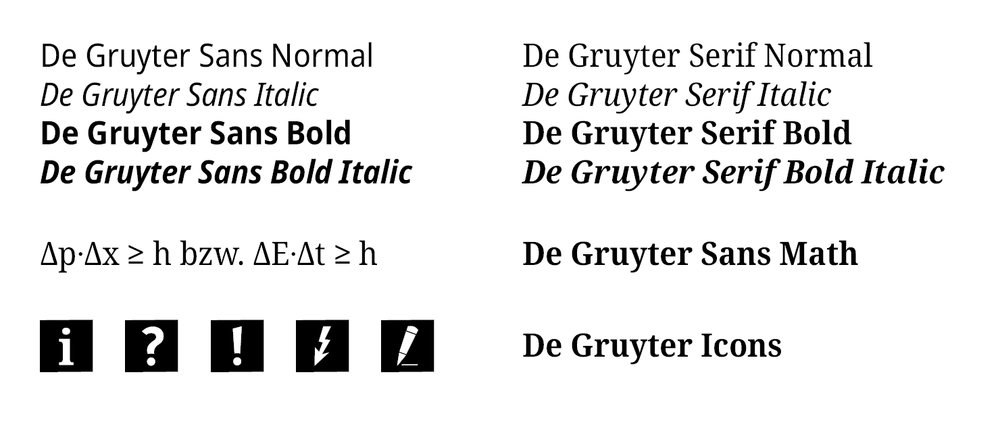

# De Gruyter Font
The new fonts are based on the [Noto](https://www.google.com/get/noto/) SemiCondensed family and have been modified in order to meet the requirements a wide variety of disciplines and publication forms.
They cover the Unicode characters for most modern scripts based on the Latin alphabet as well as Greek and Cyrillic alphabets. They further include linguistic characters (IPA and other phonetic extensions) and special characters for a wide range of specific transliteration forms (e.g., for Arabic or hieroglyphs).

The characters included in our fonts come from the following Unicode blocks:
- Basic Latin / Latin-1 Supplement
- Latin Extended Additional / Latin Extended-A/B/D
- Cyrillic
- Greek / Greek Extended
- IPA Extensions
- Phonetic Extensions / Supplement
- Spacing Modifier Letters
- Control Pictures
- Combining Diacritical Marks / Supplement
- General Punctuation
- Geometric Shapes / Arrows

For scripts beyond the Latin, Greek, and Cyrillic alphabets additional fonts must be used.
For mathematical or logical operators the additional font [De Gruyter Sans Math](/fonts/De-Gruyter-Sans-Math-Regular.otf) can be used (only in Regular style).

## Font Download
[All Fonts zipped](https://gitlab.com/degruyter-public/font/de-gruyter-sans_serif/-/raw/main/fonts/de_gruyter-sans_serif_icons.zip)

## This repository
This GitLab repository provides: 
1. The De Gruyter Fonts De Gruyter Sans, De Gruyter Serif, De Gruyter Sans Math, De Gruyter Icons. see [Fonts](/fonts)
2. The Source Code to re-create the De Gruyter font from Google's Noto SemiCondensed. see [Scripts](/scripts)

## Support
For any questions or queries please contact standards [at] degruyter [dot] com.

## License
This Font Software is licensed under the SIL Open Font License, Version 1.1.
