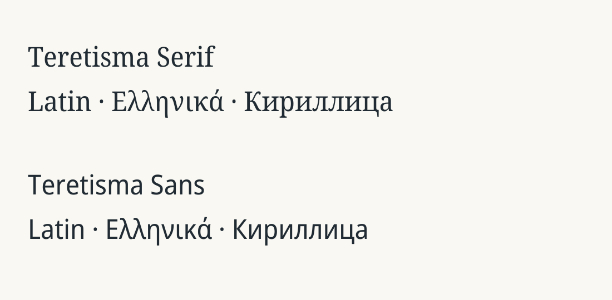

# Teretisma
The new fonts are based on the [Noto](https://www.google.com/get/noto/) SemiCondensed family and have been modified in order to meet the requirements a wide variety of disciplines and publication forms.
They cover the Unicode characters for most modern scripts based on the Latin alphabet as well as Greek and Cyrillic alphabets. They further include linguistic characters (IPA and other phonetic extensions) and special characters for a wide range of specific transliteration forms (e.g., for Arabic or hieroglyphs).

The characters included in our fonts come from the following Unicode blocks:
- Basic Latin / Latin-1 Supplement
- Latin Extended Additional / Latin Extended-A/B/D
- Cyrillic
- Greek / Greek Extended
- IPA Extensions
- Phonetic Extensions / Supplement
- Spacing Modifier Letters
- Control Pictures
- Combining Diacritical Marks / Supplement
- General Punctuation
- Geometric Shapes / Arrows

For scripts beyond the Latin, Greek, and Cyrillic alphabets additional fonts must be used.
For mathematical or logical operators the additional font [Teretisma Sans Math](/fonts/Teretisma-Sans-Math-Regular.otf) can be used (only in Regular style).

## Font Download
[All Fonts zipped](fonts/teretisma-sans_serif_icons.zip)

## This repository
This repository provides:
1. The Teretisma Fonts Teretisma Sans, Teretisma Serif, Teretisma Sans Math, Teretisma Icons. see [Fonts](/fonts)
2. The Source Code to re-create the Teretisma font from Google's Noto SemiCondensed. see [Scripts](/scripts)

## Support
Use the issue tracker of the repository hosting this independent project.

## Heritage and independent development

Teretisma is an independent continuation of the [De Gruyter font repository](https://gitlab.com/degruyter-public/font/de-gruyter-sans_serif), copied from commit `e633c0d` with its complete Git history. We gratefully acknowledge De Gruyter, le-tex publishing services, and the original contributors for the fonts, glyph customisations, build tools, and TeX integration. Teretisma is not affiliated with or endorsed by De Gruyter.

The first Teretisma commit records the unchanged imported tree; the second renames the project, fonts, build configuration, and TeX packages. Font outlines and character coverage are preserved. The inherited TeX PDF manuals have been reissued as text manuals with the renamed package references.

De Gruyter is historical provenance, not the ongoing upstream. Future dependency updates should come directly from their respective projects:

- [Noto Sans](https://github.com/notofonts/latin-greek-cyrillic), [Noto Serif](https://github.com/notofonts/latin-greek-cyrillic): SemiCondensed source families.
- [Noto Symbols](https://github.com/notofonts/symbols): supplementary symbol fonts.
- [Noto Math](https://github.com/notofonts/math): mathematical glyphs.
- [New Athena Unicode](https://apagreekkeys.org/NAUdownload.html): additional inherited glyph sources.

The inherited source snapshots remain in `scripts/source_fonts/` for reproducibility; they have not been updated to newer upstream releases as part of the rename. Repository remotes point directly to the Noto projects; there is no De Gruyter remote or branch-tracking relationship. The Minion Math TeX support files are retained; Minion Math itself is a separate dependency and is not supplied here.

## License

Fonts retain the [SIL Open Font License 1.1](fonts/LICENSE). Build scripts retain their [GNU GPL license](scripts/LICENSE). Existing copyright, author, trademark, and license notices remain intact; renaming the project does not transfer ownership of the inherited work.

Modified build scripts and TeX integration were renamed for Teretisma on 2026-11-08.

## Rename validation

The rename was checked by recursively parsing the font distribution archives and their OpenType, Type 1, TFM, and VF files. All 53 working-tree OpenType/TrueType files retain their original glyph order, character coverage, metrics, layout tables, and glyph outlines. XeLaTeX and pdfLaTeX smoke documents loaded Teretisma Serif and Sans in regular, bold, italic, and bold italic styles. Both license files are unchanged from the imported baseline.

A complete rebuild through the inherited Ruby/FontForge pipeline has not been run; those tools are not installed in the initial workspace. The checks above validate the renamed existing fonts and TeX packages.
